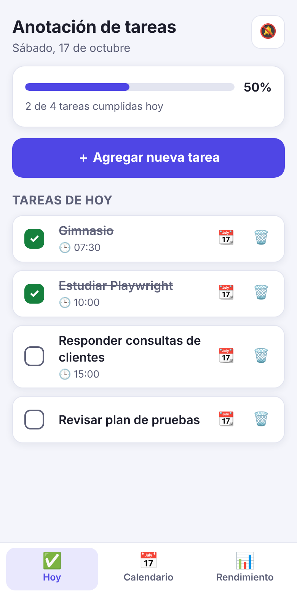
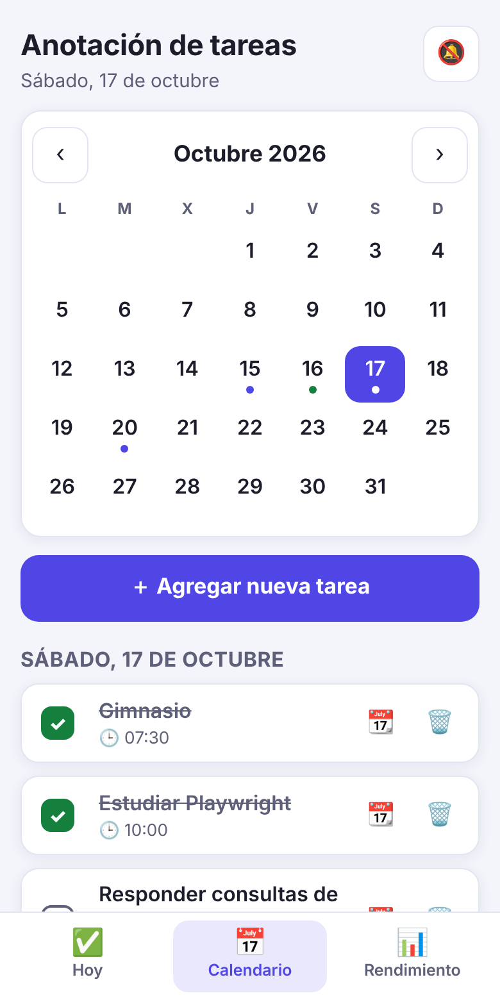
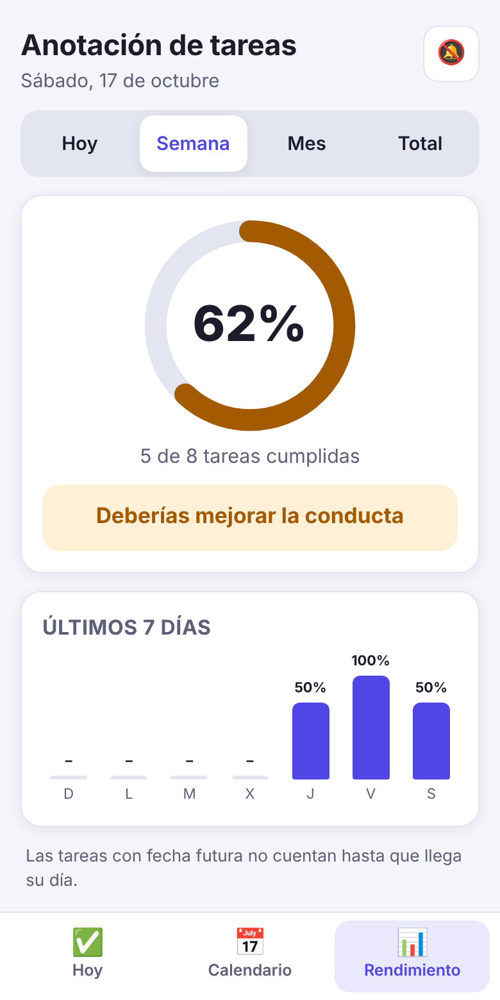

# Anotación de tareas

[](https://github.com/rodriqats/Calendar/actions/workflows/e2e.yml)

App móvil (PWA) para anotar las tareas del día, planificar a futuro en un calendario propio, medir el cumplimiento en porcentaje y llevar tareas específicas a Google Calendar.

Proyecto de portfolio de una consultora de **desarrollo web asistido por IA y QA**: la app es simple a propósito; lo que se muestra es cómo se **prueba, documenta y entrega**.

| Hoy | Calendario | Rendimiento |
|---|---|---|
|  |  |  |

**Demo en vivo:** https://rodriqats.github.io/Calendar/

## Qué hace
- Agregar tareas con el botón **Agregar nueva tarea** (nombre, fecha, hora opcional, recordatorio).
- Calendario mensual propio para anotar tareas a futuro; se guardan en el dispositivo.
- Botón por tarea para crear el evento en **Google Calendar**.
- Cumplimiento en porcentaje (hoy, semana, mes y total) con un mensaje según el resultado:

| Cumplimiento | Mensaje |
|---|---|
| 100 % | Logramos hacer todo, sigue así |
| 70 % – 99 % | Casi logramos hacer todo, pero es un gran avance |
| 40 % – 69 % | Deberías mejorar la conducta |
| 0 % – 39 % | Borra esta app por que no te sirve |

- Instalable en el celular y con modo sin conexión (service worker).
- Modo claro y oscuro automático.

## Stack y decisiones
HTML, CSS y JavaScript sin frameworks ni build: es un solo `index.html`, que carga rápido, no tiene dependencias que mantener y se aloja gratis en GitHub Pages. Un framework no aportaría valor a este alcance. El código de pruebas es **TypeScript + Playwright**.

## Calidad
- **47 casos de prueba E2E** (94 ejecuciones: perfil móvil Pixel 5 y escritorio) con fecha congelada para que sean deterministas.
- Cubren funcionalidad, casos negativos, valores límite, seguridad básica (XSS), robustez ante datos corruptos, responsive, accesibilidad básica, PWA sin conexión y todos los límites de los mensajes de rendimiento.
- Las pruebas encontraron **3 defectos reales**, ya corregidos, y cada uno quedó cubierto por una prueba de regresión. Ver [`docs/PLAN_DE_PRUEBAS.md`](docs/PLAN_DE_PRUEBAS.md).
- CI en GitHub Actions: [`.github/workflows/e2e.yml`](.github/workflows/e2e.yml).

## Ejecutar las pruebas
Requiere Node.js 20 o superior (probado con la 22).

```bash
npm install
npx playwright install chromium
npm test            # corre móvil + escritorio
npm run test:movil  # solo móvil
npm run report      # abre el informe HTML
```

La app se sirve sola en `http://localhost:4173` (`scripts/serve.mjs`, sin dependencias). Para verla a mano: `npm run serve`.

## Estructura
```
index.html              la app completa
manifest.webmanifest    datos de instalación (PWA)
sw.js                   service worker (sin conexión)
icon-*.png              íconos
tests/                  pruebas Playwright + TypeScript
docs/PLAN_DE_PRUEBAS.md plan, casos, defectos y riesgos
scripts/serve.mjs       servidor estático para las pruebas
.github/workflows/      CI
```

## Publicar en GitHub Pages
1. Subir este proyecto a un repositorio público.
2. **Settings → Pages →** *Deploy from a branch* → `main` / `(root)`.
3. Al cambiar `index.html`, subir el número `VERSION` de `sw.js` para que los celulares descarguen la versión nueva.

## Límites conocidos
- Los datos viven en el navegador de cada dispositivo (localStorage); no hay cuentas ni sincronización. No guardar información sensible.
- Los recordatorios en la app solo avisan con la app abierta. Para avisos confiables, usar el botón de Google Calendar.
- Probado solo en Chromium (ver riesgos en el plan de pruebas).
